<p align="center">
  
</p>

<h1 align="center">GeDefense TV</h1>

<p align="center"><b>面向 Android TV OS 与 Google TV 的设备端安全控制台。</b><br>
本地回环 VPN 过滤、带地理位置归属的流量地图、XDR-Light 以及诚实的状态模型。<br>
无外部 VPN 服务器。无云。无遥测。</p>

<p align="center">
  <a href="https://github.com/visiongaiatechnology/gedefense_androidtv/releases/download/v0.2.0-alpha1/VGT_GeDefense_TV_0.2.0-alpha1_VC2_release.apk"></a>
  
  
  
  
  
</p>

[English](README.md) · [Deutsch](README.de.md) · [Русский](README.ru.md) · [Français](README.fr.md) · **简体中文** · [日本語](README.ja.md)

---

> ## ⚠️ 早期 ALPHA（early alpha）——每一位用户都是 Alpha 测试者
>
> GeDefense TV **0.2.0-alpha1** 是早期 Alpha 版本。它不是成品消费级产品，也不是经过审计的安全产品，
> 发布的 APK 使用**测试签名密钥**签名。行为、界面和过滤策略会在不同 Alpha 版本之间变化。在依赖它之前：
> 请阅读[适用范围与限制](#适用范围与限制)和[发布说明](RELEASE-NOTES.md)，并将每个结果视为提示，而不是保证。

## 下载

[](https://github.com/visiongaiatechnology/gedefense_androidtv/releases/download/v0.2.0-alpha1/VGT_GeDefense_TV_0.2.0-alpha1_VC2_release.apk)

请始终使用[最新发布页面](https://github.com/visiongaiatechnology/gedefense_androidtv/releases/download/v0.2.0-alpha1/VGT_GeDefense_TV_0.2.0-alpha1_VC2_release.apk)：
确切的 APK 文件、校验和与构建说明都在那里。Alpha APK 使用测试签名——侧载时 Android 可能会警告。
安装前请对照 [SHA256SUMS.txt](SHA256SUMS.txt) 或发布页附带的校验和核对 SHA-256。

## 截图

以下为运行中的 Android TV 模拟器构建（1920×1080，Android 16 Google TV / API 36）的真实英文界面渲染。

| 首页——安全态势 | 保护——本地回环 VPN |
| --- | --- |
| 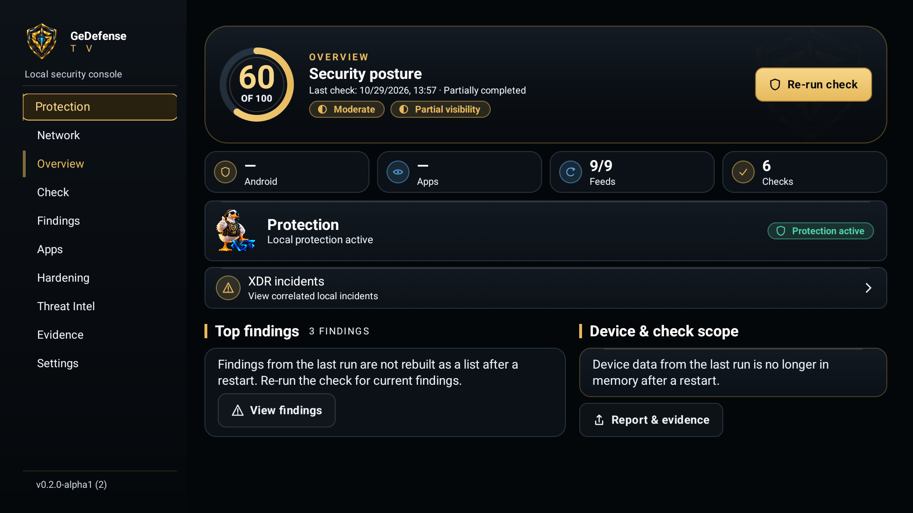 | 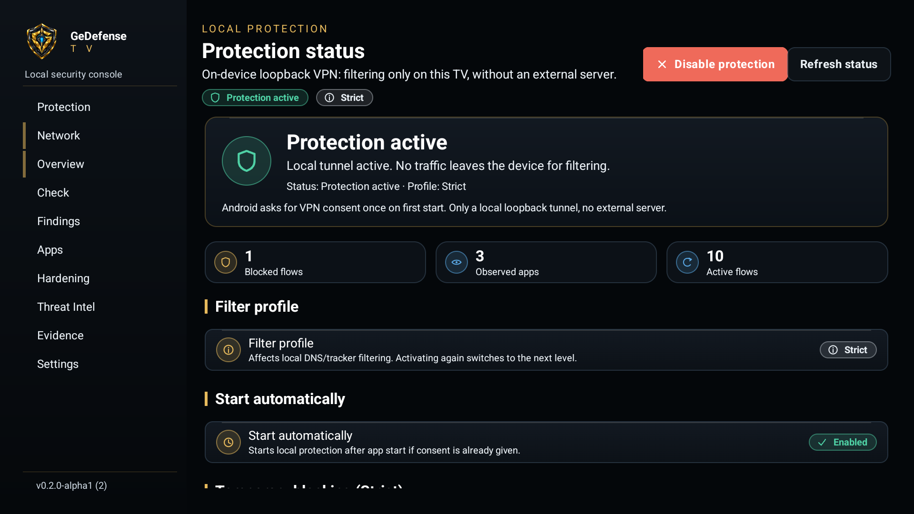 |

| 网络——流量地图与目标 | 可撤销的临时封堵弹窗（Kinetic-Lite） |
| --- | --- |
| 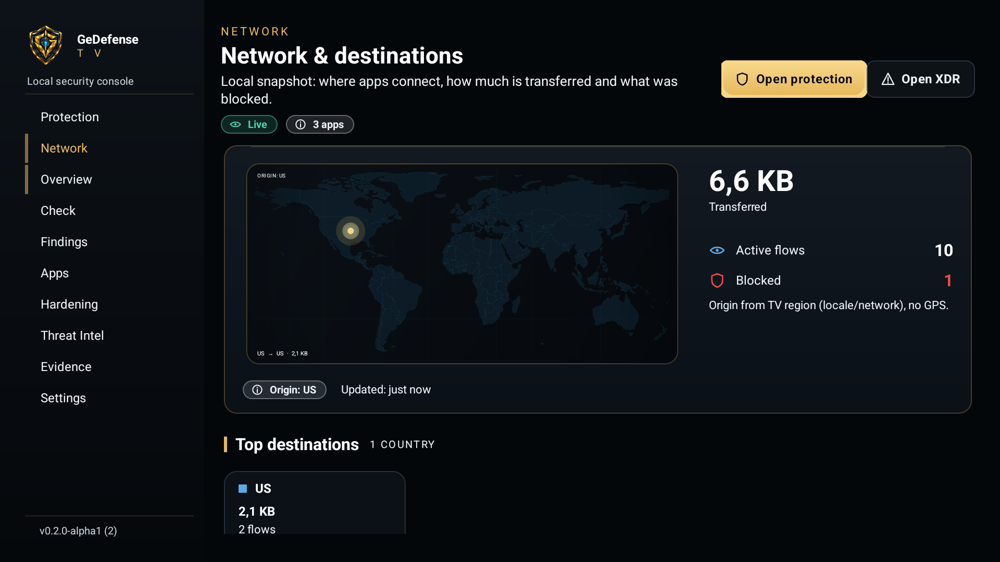 | 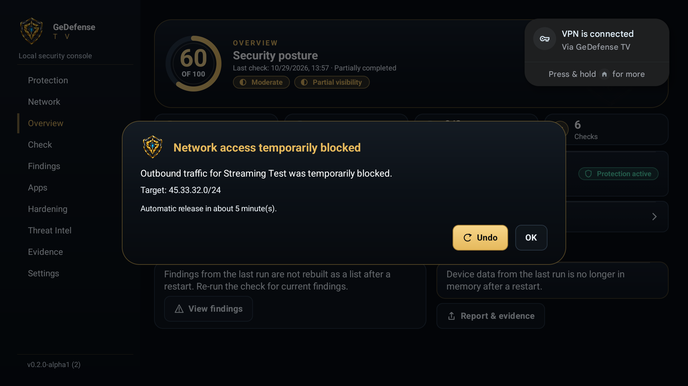 |

| 由 Sir Quacksec 引导的首次启动 | XDR-Light——关联事件 | 威胁情报同步浮层 |
| --- | --- | --- |
| 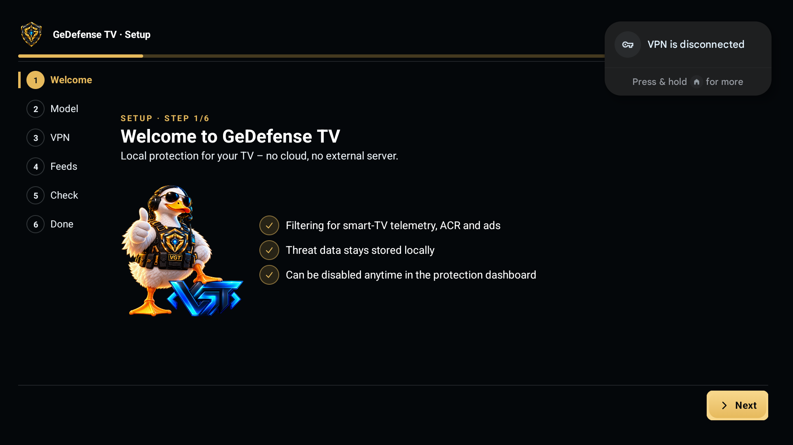 | 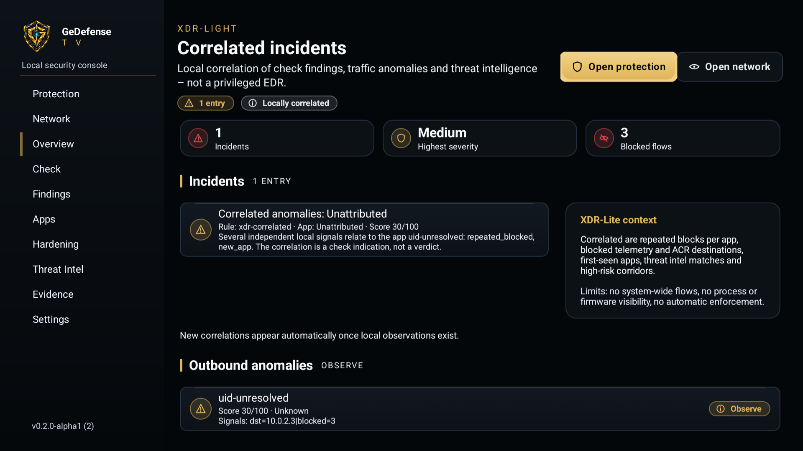 | 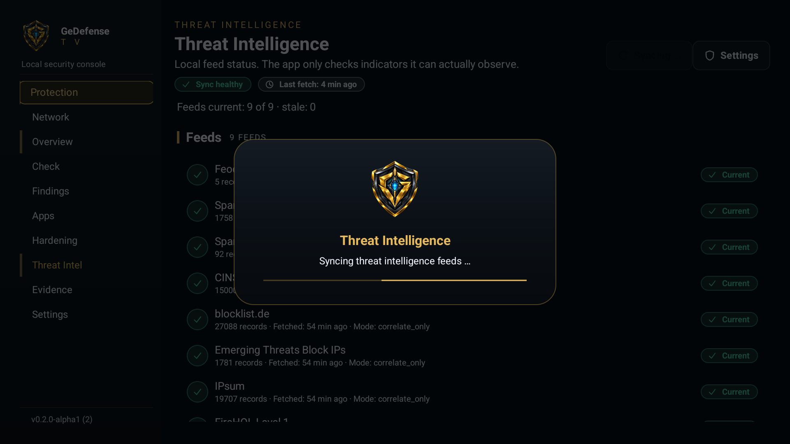 |

### 六种界面语言

界面跟随电视的系统语言。英语为默认语言；德语、法语、俄语、简体中文和日语均提供完整资源集。

| English（默认） | Deutsch | Français |
| --- | --- | --- |
|  | 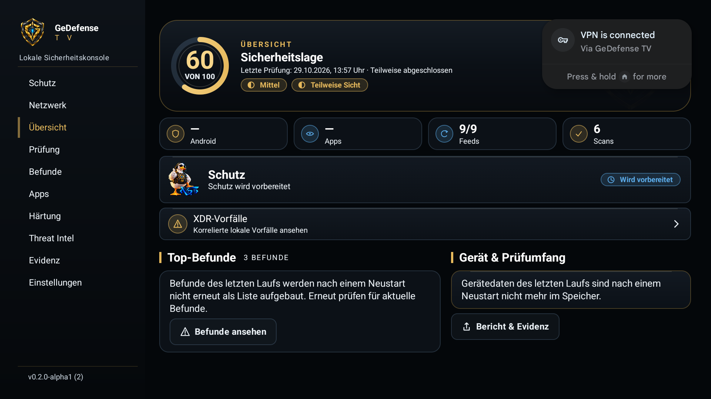 | 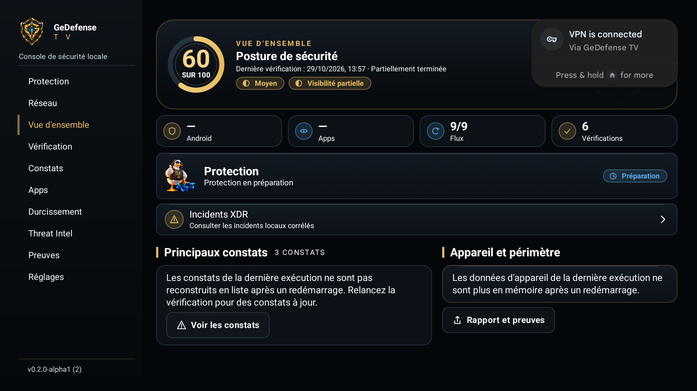 |

| Русский | 简体中文 | 日本語 |
| --- | --- | --- |
| 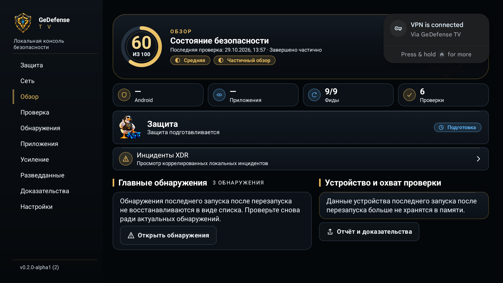 | 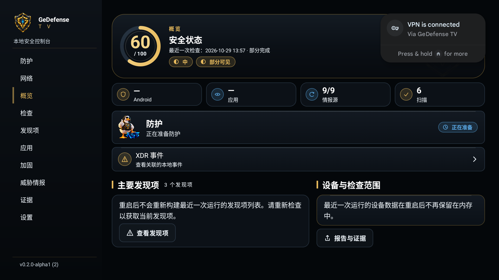 | 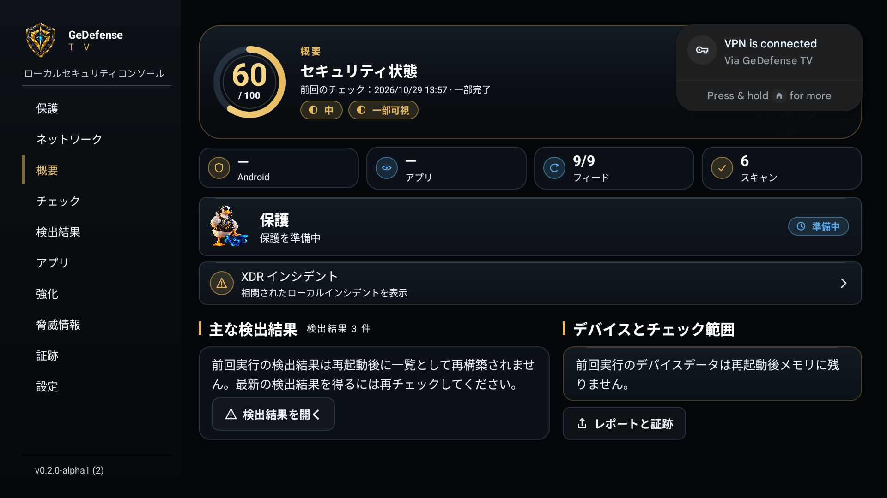 |

## GeDefense TV 是什么？

GeDefense TV 是一款面向 Android TV OS 和 Google TV、以遥控器方向键为优先的安全应用。它把本地过滤层
与本地可观测控制台结合在一起：展示电视在网络上的行为、被封堵的内容、哪些应用与哪些国家通信，以及
哪些发现在该设备上确实可验证。

核心原则：**只报告在本设备上可观测到的情况。**缺失权限、不支持的 API 或部分可见性都会显示为部分可见性，
绝不被当作电视“干净”的证据。只有在隧道真正运行时，才会声明保护状态。

本应用是**独立的电视应用**。它不是路由器、防火墙网关或网络传感器，也不与路由器固件集成。

### 为什么使用纯本地回环 VPN？

GeDefense TV 直接在设备上过滤。应用创建本地 TUN 接口，将自身流量导入其中，并由随附的、经过审计的
数据面助手评估 DNS 与连接元数据。过滤后的流量随后直接从设备发往目标。

这种设计带来有意的结果：

- **无外部服务器、无账户、无订阅。** 流量不经过 VGT 服务器或任何第三方 VPN 端点，因此中间没有需要信任的一环。
- **不检查内容。** 仅评估 DNS 与连接元数据。TLS/QUIC 内容保持加密且不被触碰——这不是 MITM 代理，无法查看 HTTPS 内部。
- **本地证据。** 发现、计数与证据都留在电视上。没有任何上传。
- **诚实的失败。** 如果缺少同意、助手启动失败或策略无法评估，应用会报告降级/失败状态，而不是让流量在无过滤状态下静默通过。

## 功能

### 本地保护（回环 VPN）

- 设备端 TUN 服务（`VpnService`、前台服务、支持 Always-On），并为 `arm64-v8a` 与 `x86_64` 提供随附的原生助手。
- 通过 Android 一次性 VPN 同意进行启动/停止；可选在应用启动后自动启动。
- 过滤配置文件：**Off**、**Conservative**、**Balanced**、**Strict**——每个配置文件改变对已知遥测、ACR、广告、跟踪器和 C2 目标的处理强度。
- 明确的状态模型：Off、Preparing、Active、Limited、Failed、Not supported。只有本地隧道真正运行时才显示“Active”。
- 实时计数：被封堵的流、已观察应用、活动流以及自启动以来传输的流量。

### 过滤：DNS、跟踪器、ACR、广告与 C2

- 依据随附的威胁索引、经过整理的跟踪器/遥测目录以及所选隐私配置文件，对 DNS 查询和连接目标进行本地评估。
- 动作可解释：允许、标注、关联或封锁——原因来自本地策略，而非远程裁决。
- 来自公开 IOC 列表的有界威胁情报缓存；过期的订阅源会被标注，而不是隐藏。
- 诚实的限制：如果应用使用 DNS-over-TLS/HTTPS，其域名不可见；应用会如实说明，而不是猜测。

### 带本地地理归属的流量地图

- 按应用、国家和域名聚合已观察流量：字节数、活动流、被封堵的流、已关联的流。
- 世界地图显示国家标记和根据电视区域/网络推导的来源标记——**不使用 GPS，也不申请位置权限**。
- IP→国家归属使用一次性下载并带 SHA-256 校验的离线数据集；国家归属只是估算（CDN、任播和共享托管可能被错误归属）。
- 有界且尊重隐私的数据：无载荷、无屏幕内容、无音频/视频、无逐包日志。

### XDR-Light

将本地可观测内容关联为可解释的事件：每个应用的重复封堵流、被封堵的遥测/ACR 流量、首次出现的应用流量、
C2 情报匹配以及高风险国家通道（仅作提示）。每个事件都带有规则、置信度、可见性和建议。已去重、有界，
并且明确**不是**特权 EDR：不做系统级流量、不做进程监控、不声明固件完整性。

### V2.1 Outbound Kinetic-Lite

对已观察的出站流量在滑动时间窗内进行确定性的有界启发式分析：DNS 突发、目标扇出、信标模式、流量尖峰、
重复封堵、跟踪器类别、C2 匹配和高风险通道。每个异常都是带有具名信号的评分——绝不是“恶意软件”裁决。

**默认仅观察。**临时封堵是显式选择加入的功能，仅在“Strict”配置文件中可用。启用后仅封堵目标前缀（绝不封堵应用），
并带有严格护栏：至少两个独立信号、最低评分、已知目标国家、短 TTL（1–30 分钟，默认 10 分钟）、最多四个活动封堵，
以及平台、Google 和 CDN 网段的允许列表。每次封堵都可撤销：会显示电视弹窗，用户可按**撤销**，封堵会在 TTL 到期后自动解除。

### 由 Sir Quacksec 引导的首次启动向导

六步、纯方向键操作的设置向导：欢迎、本地保护原理、VPN 同意、威胁情报同步（可跳过）、首次检查，以及激活完整保护的总结。
没有任何伪造：如果同意被拒绝或某一步失败，向导会如实说明。

### 威胁情报同步浮层

方向键安全的浮层在更新公开 IOC 订阅源时显示同步进度。过期或失败的同步会如实报告，并可稍后重试。

### 证据、报告与导出

- 本地证据账本，带 HMAC 校验的哈希链与加密载荷；密钥丢失时按 fail-closed 处理，而不是静默开始新的链。
- 本地文本和 JSON 安全报告。
- 通过系统文件选择器（SAF）导出；在没有文档选择器的电视系统上，应用使用无需权限的 `Downloads/GeDefenseTV` 回退路径，并告知用户文件的写入位置。

### 六种语言，完整本地化

英语（默认）、德语、法语、俄语、简体中文和日语——每个界面字符串都有完整资源集，并由仓库的翻译检查工具校验。

### 设备审计与发现

除过滤之外，GeDefense TV 保留了产品最初提供的只读审计面：

- **设备态势：**Android 版本/API 级别、构建指纹、ABI 与安全补丁时效分类——明确属于元数据，不是漏洞保证。
- **可见应用：**版本、安装来源、签名摘要以及与基线的“新增/变更”状态，并如实展示 Android 包可见性限制。
- **加固检查：**ADB/调试、开发者选项、test-keys/userdebug 构建、设备管理员、无障碍服务和商店外安装器——
  三态判定，不可读的值保持不可读，绝不被视为“安全”。
- **发现与威胁情报：**带严重性、置信度和可见性的可解释发现，以及本地订阅源新鲜度和指标匹配。

### 诚实的状态模型

状态模型本身就是产品：能力与可见性是一等数据。与其给出绿色的“安全”徽章，不如在覆盖充分时给出态势评分、
明确的部分可见性标签，以及清晰说明哪些内容无法观测。

## 工作原理

```text
Android TV / Google TV（未 root）
┌──────────────────────────────────────────────────────────────────────────┐
│ :app  （普通应用沙箱，无 AndroidX，无第三方运行时库）                      │
│   UI（Views、方向键）  Protection  Network  XDR  Onboarding  Settings     │
│   契约 / 服务                                                             │
│        │                                                                  │
│   TvVpnService（前台服务，本地 TUN）                                      │
│        │  有界控制 + 遥测                                                 │
│        ▼                                                                  │
│   GaiaNet 助手（随附原生 .so，子进程，无 root）                           │
│        DNS/流策略  →  直接出站至目标                                      │
└──────────────────────────────────────────────────────────────────────────┘
     :tv-core — 纯 JVM 领域：扫描、评分、流量、XDR、异常、封堵策略、地理、报告、事件
     :core    — 随附的 GeDefense Mobile 核心，字节级一致
```

## 适用范围与限制

GeDefense TV 有意**不是**：

- 外部 VPN 或地区解锁服务——没有服务器，也没有任何流量被隧道转发到设备之外；
- 杀毒软件或恶意软件清除工具——它观察网络行为并报告，但不会清理应用；
- 特权 EDR——无内核访问、无 root、无系统级进程或流量监控；
- 路由器/网关/防火墙替代品——它只运行在电视上；
- 完整的应用清单——Android 包可见性限制了应用能看到的内容；
- 保护保证——过滤只覆盖真正经过本地数据面的流量，且只覆盖它已知的策略。

其他已知限制：

- **Alpha 质量：**尚未在真实电视硬件（OEM 设备）上验证；当前证据基础是模拟器行为。
- **DNS 可见性：**DoT/DoH 流量会使域名对本地观察不可见。
- **地理归属是近似值：**CDN、任播和共享托管可能被归属到错误的国家。
- **封堵按设计是临时的：**短 TTL、最多四个活动封堵、易于撤销——不是永久防火墙规则。
- **测试签名的 Alpha APK：**不是生产签名的构建；侧载需要允许未知来源。

## 安全与隐私

- **无遥测、无分析、无广告、无崩溃上报 SDK。**应用不包含任何第三方运行时 SDK。
- **不采集内容：**不采集屏幕、音频、视频或载荷；不做 TLS 拦截。
- **默认本地处理：**流量元数据、发现和证据都保留在设备上。
- **最小权限：**`INTERNET`、`ACCESS_NETWORK_STATE`、`FOREGROUND_SERVICE`、`FOREGROUND_SERVICE_SPECIAL_USE`、
  `POST_NOTIFICATIONS`，以及服务权限 `BIND_VPN_SERVICE`。不使用位置、无障碍、悬浮窗、相机、麦克风或 `QUERY_ALL_PACKAGES`。
- **只有公开数据离开设备：**威胁情报订阅源和 IP→国家数据集通过 HTTPS 获取；不上传任何设备数据。
- **安全报告：**参见 [SECURITY.md](SECURITY.md)。请勿在公开 issue 中发布可利用细节。

完整数据清单：[PRIVACY.md](PRIVACY.md) · [DATA-SAFETY.md](DATA-SAFETY.md)。
安全设计与威胁模型：[SECURITY.md](SECURITY.md) · [THREAT-MODEL.md](THREAT-MODEL.md)。

## 要求

| 组件 | 要求 |
| --- | --- |
| 设备 | Android TV OS / Google TV，`minSdk 26`（Android 8.0）或更高，`arm64-v8a` 或 `x86_64` |
| 电视界面 | 兼容 Leanback 的启动器，方向键遥控器（无需触摸） |
| 构建 | JDK 17、Android SDK 平台 36、Build-Tools 36.0.0、Gradle 8.7（含 wrapper） |
| 运行时依赖 | 无——无 AndroidX，无第三方库 |

## 安装（侧载）

1. 在电视上，为你用来安装 APK 的应用（侧载/文件管理器应用或 ADB）允许安装未知来源应用。
2. 从[最新发布](https://github.com/visiongaiatechnology/gedefense_androidtv/releases/download/v0.2.0-alpha1/VGT_GeDefense_TV_0.2.0-alpha1_VC2_release.apk)安装 APK。
3. 启动 **GeDefense TV**，按首次向导操作，并接受 Android 的一次性 VPN 同意对话框。
4. 可选，通过 ADB：

```bash
adb connect <tv-ip>:5555
adb install -r VGT_GeDefense_TV_0.2.0-alpha1_VC2_release-debugsigned.apk
adb shell am start -n de.visiongaia.gedefense.tv/.TvMainActivity
```

Alpha APK 使用**测试签名**。本 Alpha 不包含生产签名密钥。

## 从源码构建

```bash
git clone https://github.com/visiongaiatechnology/gedefense_androidtv.git
cd gedefense_androidtv

export JAVA_HOME=/path/to/jdk-17
export ANDROID_HOME=/path/to/android-sdk

./gradlew :app:assembleDebug           # 调试 APK
./gradlew :app:assembleRelease         # R8 压缩的发布 APK
```

发布签名从环境变量 `GEDEFENSE_RELEASE_STORE_FILE`、`GEDEFENSE_RELEASE_STORE_PASSWORD`、
`GEDEFENSE_RELEASE_KEY_ALIAS` 和 `GEDEFENSE_RELEASE_KEY_PASSWORD` 读取。缺少这些变量时，构建会回退到调试签名配置——
适合 Alpha 测试，不适合分发。更多信息：[BUILD-RUNBOOK.md](BUILD-RUNBOOK.md)。

## 测试

```bash
./gradlew :tv-core:tvCoreCheck     # 核心领域测试
./gradlew :tv-core:tvV2Check       # 流量 / 隐私 / XDR 领域测试
./gradlew :tv-core:tvKineticCheck  # V2.1 异常与封堵测试
./gradlew :app:lintDebug           # Android lint
```

随附核心的测试（`:core:coreCheck`）需要 Linux/macOS JVM：其持久化文件代码使用目录 `fsync`，Windows 不支持。
包含创建 AVD 与截图的 Android TV 模拟器指南见 [docs/TV-EMULATOR-TESTING.md](docs/TV-EMULATOR-TESTING.md)。
验收矩阵见 [TEST-PLAN.md](TEST-PLAN.md)。

## 项目结构

```text
.
├── app/                    Android TV 应用模块（Views，无 AndroidX）
│   └── src/main/            java/ · res/（6 种语言）· assets/ · jniLibs/ · AndroidManifest.xml
├── core/                   随附的 GeDefense Mobile 核心，字节级一致（纯 JVM）
├── tv-core/                纯 JVM 领域：扫描、评分、流量、XDR、异常、报告
├── docs/                   架构、流量地图、首次向导、设计 DNA、模拟器指南、
│                           screenshots/ 与 assets/
├── tools/                  构建/测试/模拟器/遥控/校验脚本
├── gradle/ + gradlew*      Gradle 8.7 wrapper（发行包 SHA-256 已固定）
├── build.gradle.kts        AGP 8.5.2 · Kotlin 1.9.24 · Java 17
└── settings.gradle.kts     模块 :core、:tv-core、:app
```

## 文档

| 文档 | 内容 |
| --- | --- |
| [ARCHITECTURE.md](ARCHITECTURE.md) | 模块图、数据流、采集器、证据、性能预算 |
| [docs/V2-ARCHITECTURE.md](docs/V2-ARCHITECTURE.md) | 回环 VPN、遥测、流量聚合、原生助手供应链 |
| [docs/TRAFFIC-MAP.md](docs/TRAFFIC-MAP.md) | 流量地图的数据来源、限制、颜色与隐私 |
| [docs/ONBOARDING.md](docs/ONBOARDING.md) | 首次启动向导、同意与权限说明 |
| [docs/DESIGN-DNA.md](docs/DESIGN-DNA.md) | 电视设计系统、焦点/交互规则、禁止模式 |
| [SECURITY.md](SECURITY.md) | 安全设计、密钥保管、权限、报告政策 |
| [THREAT-MODEL.md](THREAT-MODEL.md) | 资产、信任边界、STRIDE 分析、电视特有风险 |
| [PRIVACY.md](PRIVACY.md) | 数据清单、保留、导出、权限理由 |
| [TEST-PLAN.md](TEST-PLAN.md) | 验收矩阵与证据要求 |
| [BUILD-RUNBOOK.md](BUILD-RUNBOOK.md) | 构建、签名、日志与故障排查 |
| [docs/TV-EMULATOR-TESTING.md](docs/TV-EMULATOR-TESTING.md) | Android TV 模拟器分步指南 |
| [docs/SOURCES.md](docs/SOURCES.md) | 来源与参考 |
| [RELEASE-NOTES.md](RELEASE-NOTES.md) | 本 Alpha 的变更与验证状态 |

## 许可证与第三方声明

GeDefense TV 是 **VisionGaiaTechnology（VGT）的专有软件**。本仓库的发布是为了透明、审查和 Alpha 测试。
发布本身不授予再分发或创作衍生作品的许可——参见 [LICENSE](LICENSE)。

第三方组件、随附二进制、资源以及运行时数据源（公开威胁情报订阅源、公开的 IP→国家数据集、原生助手中的 Go 标准库）
记录在 [THIRD_PARTY_NOTICES.md](THIRD_PARTY_NOTICES.md) 中。

## Alpha 反馈

欢迎通过 [GitHub Issues](https://github.com/visiongaiatechnology/gedefense_androidtv/issues) 提供反馈。
请注明设备型号、Android TV OS 版本以及设置中显示的应用版本。请勿在公开 issue 中发布机密、个人数据或可利用的安全细节——
参见 [SECURITY.md](SECURITY.md)。

---

<p align="center"><i>GeDefense TV 是 VisionGaiaTechnology 的项目。<br>
“The humor is load-bearing. The code is not a joke.”</i></p>
